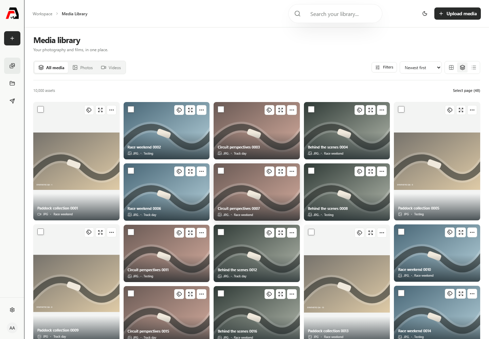
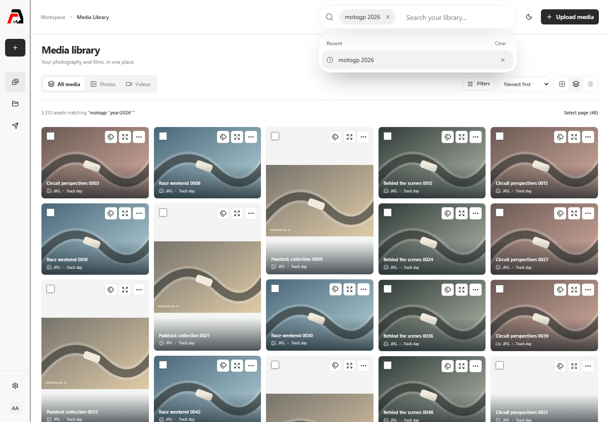
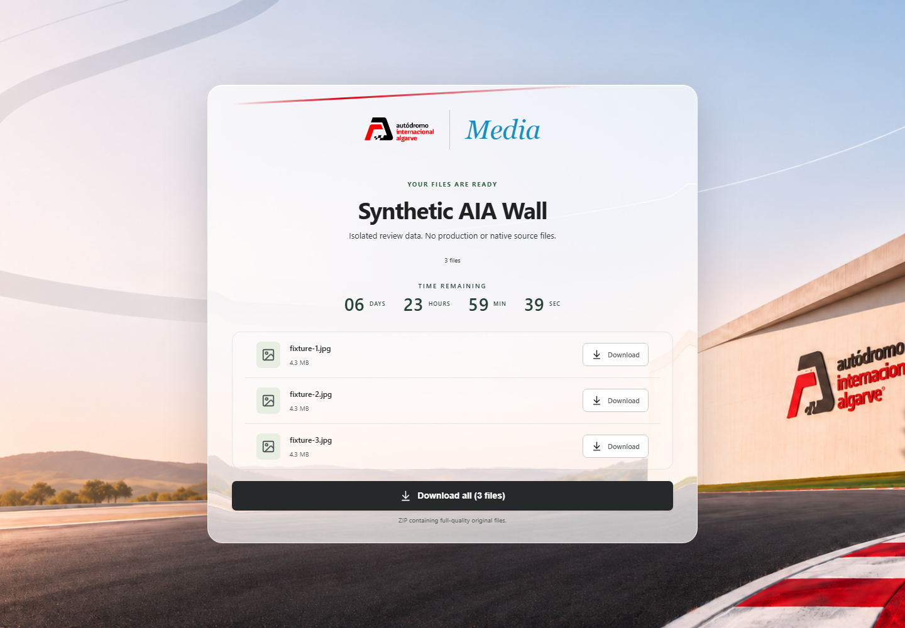
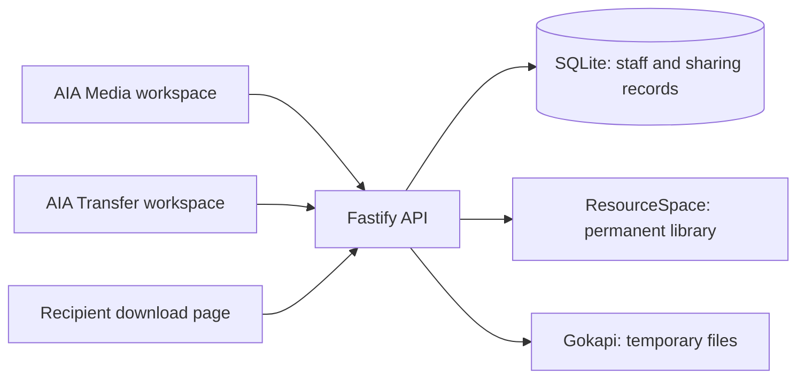

# AIA Media

A shared home for the Algarve International Circuit's photography, films and stories.

AIA Media helps the team find the right shot, keep it organised and send it to someone else. The permanent media library and temporary file transfers live in the same workspace, while recipients get a simple download page that doesn't require a staff account.



_Screenshots use synthetic demonstration media and approved public artwork. They contain no private library photos._

## What you can do

- **Find media quickly.** Search names, keywords, events and years, then narrow the results with filters. `MotoGP 2026` works in one search pill or as separate pills; capitalisation doesn't matter. Results must match all entered terms.
- **Organise the library.** Add or remove tags directly from thumbnails, edit several selected items together and build collections for a project or event.
- **Work with the originals.** Browse an infinitely scrolling grid, masonry or list, open a fullscreen preview and upload media through the same workspace. Offscreen thumbnails are released; a manual Load more option is available. Preview images stay separate from original downloads.
- **Share a selection.** Create an expiring link from library assets, add a password or download limit, and revoke it when needed.
- **Send temporary files.** Upload a separate transfer without adding those files to the permanent library. Larger uploads support pause and resume.
- **Download everything together.** Recipients can download individual files or one ZIP containing the full-quality originals. Files are never resized or recompressed as images. Duplicate filenames are kept with numbered suffixes.
- **Invite the team.** An administrator creates an invitation link and sends it to the new member. They choose a password, add a profile photo and set up an authenticator before gaining access. Their photo then appears throughout the workspace.
- **Make the workspace yours.** Use light or charcoal dark mode. Administrators can manage the separate public photos shown behind the login and signup pages; private library images stay private.

## A search that follows your thinking

Type a few words and press Enter to keep them as a pill. Add more words whenever you need to narrow the results. Splitting a query into pills doesn't change its meaning: `Racing Circuit`, for example, looks for both terms across the searchable metadata.



## Sharing without the back-and-forth

The recipient opens a link, enters its password if one was set, and downloads the files. They don't need a staff login. Expiry, revocation and download limits still apply to the ZIP; one ZIP counts as one download start.



## Try it locally

You need **Node.js 22.17 or later, below 23**, and **pnpm 10.14.0 through Corepack**.

```sh
git clone https://github.com/LV1DOR/AIA-Media-DAM.git
cd AIA-Media-DAM
corepack enable
corepack pnpm install --frozen-lockfile
corepack pnpm preview:review
```

The command builds both interfaces and starts an isolated review environment:

| Interface          | Address               |
| ------------------ | --------------------- |
| Media workspace    | http://127.0.0.1:3310 |
| Transfer workspace | http://127.0.0.1:3311 |

On the first start, sign in with **`admin` / `synthetic-review-admin-only`**. These are demonstration credentials only. Existing credentials are reused on later starts; the bootstrap does not reset them. The console also prints a seeded recipient link. Use **Settings → Staff** to try the invitation flow with an authenticator app.

The preview runs on this computer only. Its media, collections and transfers are synthetic and reset on restart. **Staff accounts, invitations, authenticator setup and profile photos persist separately**, through a dedicated authentication API and a file-backed registry. On Windows their default location is `%LOCALAPPDATA%\AIA-Media\review-identity`; on Linux it is `$XDG_DATA_HOME/AIA-Media/review-identity`, falling back to `~/.local/share/AIA-Media/review-identity`. It never connects to the NAS or uses production credentials. Stop it with Ctrl+C, or type `stop` in its console.

Preserve the identity directory and its original key when moving or backing up the preview. Rebuilding the interface, switching branches or restarting the service does not reset accounts. Tests use separate isolated identity directories. See [account persistence and security](docs/infinite-auth/REVIEW.md) for the lifecycle, backup and recovery boundaries.

## How it is put together

The two Next.js interfaces share React components and talk to a Fastify API. The API manages staff access and sharing, while ResourceSpace owns the permanent library and Gokapi owns temporary transfer storage. SQLite stores application records, not the original media library.



| Folder                          | Purpose                                                         |
| ------------------------------- | --------------------------------------------------------------- |
| `apps/media-web`                | Library and staff workspace                                     |
| `apps/transfer-web`             | Transfer workspace and recipient pages                          |
| `packages/ui`                   | Shared interface and adapted upstream components                |
| `packages/contracts`            | Shared validation and data contracts                            |
| `services/transfer-api`         | Authentication, invitations, uploads, sharing and ZIP streaming |
| `services/resourcespace-plugin` | Narrow integration through native ResourceSpace functions       |
| `infra/compose`                 | Container and HTTPS ingress configuration                       |

Native credentials stay on the server. Application code uses native APIs rather than writing directly to the media engines' databases. Runtime configuration, keys, databases and real media are excluded from Git.

## Checks before a change ships

```sh
corepack pnpm check
corepack pnpm format:check
corepack pnpm scan:secrets
corepack pnpm exec playwright install chromium
corepack pnpm test:browser
corepack pnpm audit --prod --audit-level high
```

`check` runs typechecking, API/model tests and both builds. Browser tests use local synthetic sources and exercise the optimised interfaces, including responsive layouts, permissions, search, tags, uploads, invitations and downloads. ZIP tests compare extracted file bytes with the originals. On Linux, Playwright may need `install --with-deps chromium`.

These checks support a review; they do not prove that a particular NAS deployment or public Internet route works. The GitHub Actions workflow runs the same core gates when pushed. Check [GitHub Actions](https://github.com/LV1DOR/AIA-Media-DAM/actions) for remote results; local evidence is recorded separately.

## Deployment and operating notes

This branch contains the frontend review candidate. Preparing or pushing a commit does **not** deploy it. Production changes require a separate deployment step and verification of the native engines, HTTPS configuration and recovery path.

- [Current status and evidence](STATUS.md)
- [Staff guide](docs/operations/STAFF_GUIDE.md)
- [IT runbook](docs/operations/IT_RUNBOOK.md)
- [Deployment and rollback](FRONTEND_DEPLOYMENT.md)
- [Known limitations](docs/KNOWN_LIMITATIONS.md)
- [Latest search and Git handoff](docs/github-handoff/REVIEW.md)
- [Infinite gallery, account persistence and security](docs/infinite-auth/REVIEW.md)
- [Smooth cursor behavior and accessibility](docs/cursor/REVIEW.md)

The current milestone uses local accounts and LAN HTTPS. Corporate single sign-on, automatic invitation email and public Internet ingress are not configured. Administrators send invitation links themselves. Private gallery photos are never automatically published as login backgrounds.

## Source and licensing

This repository combines application code, owner-supplied branding and adapted third-party components. It is **not covered by a single blanket open-source licence**. In particular, the React Bits components retain MIT + Commons Clause terms, and the branding and artwork are not relicensed by this repository.

See [component sources and licences](COMPONENT_SOURCES_AND_LICENSES.md) and [third-party notices](docs/THIRD_PARTY_NOTICES.md) before redistributing anything. ResourceSpace and Gokapi remain separate upstream applications with their own licences and source obligations. No paid Media Vault template is included.
